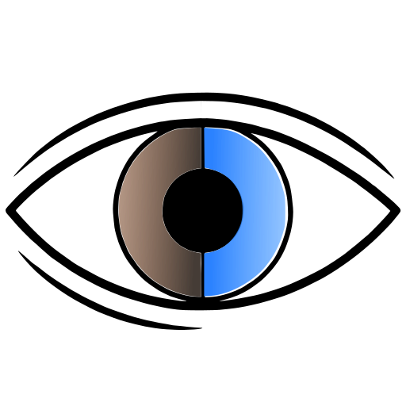

#  Twinshot — Make "clean room" implementation of every program in the earth!

Save and compare screenshots of the functionality of other applications you
want to copy end to end: a proven **oracle** tree against the **current**
state, 1:1 parity between two folders of snapshots (screenshots, HTML, text).

## Use cases

- **Pixel-perfect design from mockups** — export every screen from Figma or a
  sketch into `oracle/`, screenshot your implementation into `current/`, and
  twinshot verifies it pixel-by-pixel: a tolerance (`png.max_diff_ratio`) for
  antialiasing, a red diff image and a heat-zone overlay showing exactly where
  you drifted. "Matches the design" stops being an opinion.
- **Clean-room reimplementation** — rebuilding an app on a new stack
  (the gem's origin: a Rails app rewritten in crails): snapshot both versions
  and drive to 1:1 parity, screen by screen.
- **Upgrade/refactor safety net** — before a framework or Ruby major upgrade,
  snapshot pages before and after; zero diff proves the UI didn't move.
- **AI agent feedback loop** — an agent implements, `twinshot compare` writes
  `report_for_agent.md` designed to be fed back to the model; exit codes
  fit CI and `git bisect run`.
- **Golden-master testing** — not just pixels: rendered HTML compared by
  canonicalized DOM structure, JSON/CSV/logs by line diff — catch structural
  regressions with no flaky selectors.
- **Cross-browser parity** — the same pages screenshotted in different
  browsers/OSes, compared as trees.

## How it works

1. **Structure**: the `current` file tree must match `oracle` 1:1. An extra
   or missing file is a failure.
2. **Files**: every file is compared by its extension's adapter. No adapter —
   failure (no fallbacks).
3. **Report**: a self-contained HTML gallery (`report_for_human.html`) +
   a markdown report for LLM agents (`report_for_agent.md`) + `summary.json`.

Adapters:

| Type  | How it compares                                                       |
|-------|-----------------------------------------------------------------------|
| `png` | bytes fast-path → pixel-by-pixel; threshold `png.max_diff_ratio`; diff image (red) + purple heat-zone overlay |
| `html`| by DOM structure: canonicalization (nokogiri: no comments, whitespace collapsed, attributes sorted) → line diff |
| `xml` | by structure like html, via the XML parser (case-sensitive names): canonicalization → line diff (`xml`, `svg`) |
| `txt` | line diff (`txt`, `md`, `log`, `json`, `csv`)                          |
| `bin` | byte-wise SHA-256 (`bin`, `dat`)                                       |

## Config — `twinshot.yml`

```yaml
oracle:
  path: artifacts/rails
  generate: bin/record            # optional

current:
  path: artifacts/crails
  generate: bin/record --crails   # optional

png:
  max_diff_ratio: 0.002           # optional, default 0.002 (applies to all groups)

soft_check:                       # optional: exact tree-relative file paths
  - dashboard/header.png          # whose content diffs are tolerated (clocks,
                                   # dates…) — reported as warnings, exit code stays 0

# optional: named groups — additional tree pairs with the same fields
# (path + generate per side). Any names work.
groups:
  dogs:
    oracle:
      path: artifacts/dogs-rails
      generate: bin/record --dogs
    current:
      path: artifacts/dogs-crails
```

The top-level `oracle`/`current` pair is the unnamed **default group**;
`compare` runs every group in order, and `groups` in the yaml adds named ones
(the name `default` is reserved). There is nothing special about an
"API-style" group: if you need to compare not just the output but the input
too, simply put the input artifacts into the group's trees — they are
compared by the same adapters.

Every group writes its report into its own folder:
`<config dir>/twinshot-report/<group>/` — the default group reports into
`twinshot-report/default/`. Each folder holds the same layout as before:
`report_for_human.html`, `report_for_agent.md`, `summary.json`, `diffs/`.
Not configurable.

Paths listed in `soft_check` (exact tree-relative paths, the same list for
every group) are snapshots whose content is allowed to differ — typically
screenshots with a clock or other dynamic content. Their diffs come back as
**warnings**: fully visible in both reports and counted separately, but they
never change the exit code. Structure problems (missing/extra files) are
never softened.

## Commands

```
twinshot compare [-c PATH] [-j N] [--json] [--[no-]open]  # compare all groups, write reports
twinshot generate [-g NAME|all] [oracle|current]  # run generate commands
twinshot help [COMMAND]                      # help
```

- `compare` in the happy case needs no generation — it takes the folders as
  they are.
- `-j N` — worker pool (forks, default: core count, capped at 8): the
  structure is checked synchronously, files in parallel.
- After `compare`, the default group's report opens in a browser: on a tty —
  automatically, `--open` — force it (even with `--json`), `--no-open` —
  disable. Cross-platform "open" (`Twinshot::Opener`): darwin — `open`,
  windows — `start` via `cmd /c`, linux/BSD — `xdg-open`; a failed launch
  does not affect the exit code.
- `generate` without a side regenerates **every configured tree** — all
  groups, `oracle` then `current`, sequentially — and announces the list
  first: `Generate:` followed by `group/side` for each target. With a side
  (`generate oracle|current`) it stays single-tree: the default group unless
  `-g`; `-g dogs` — a named one, `-g all` — runs the side's command in every
  group where it is configured. A failing command doesn't stop the rest, but
  the exit code reports it.
- Exit codes: `0` — everything matched, `1` — differences found (fits
  `git bisect run` and CI), `2` — config/usage error. `soft_check` warnings
  never affect the exit code.

## Report

Two files per group folder:

- `report_for_human.html` — the visual report (opened in a browser after
  `compare`):
  - flat gallery ordered by folder (one card per file, no folder headings);
  - substring search, filters all/failed/warned/passed;
  - image modes: **side-by-side** (50/50), **slider** (overlay with a handle),
    **blink** (oracle/current alternating);
  - **zones** — a purple overlay over images: the picture is split into 32×32 px
    squares, a square's opacity grows with the share of differing pixels (`heat`
    metadata in `summary.json`, a toolbar toggle);
  - inline text diffs (`+/-` lines);
  - `n`/`p` keys — navigate shots, `Esc` — reset search.
- `report_for_agent.md` — the same results as markdown to feed to a model:
  every failed file gets a section with its metadata (absolute oracle/current
  paths, kind, detail, ratio, diff-image path) plus the divergence snippet as a
  unified-style `diff` fence — the same line diffs the human report renders
  inline (for `html` that is the canonicalized DOM line diff, so the snippet
  shows what structurally differs, not raw source noise). Passed files are a
  plain list at the bottom.

## Install and development

```sh
bundle exec rake test && bundle exec rake build   # pkg/twinshot-X.Y.Z.gem
```

Ruby >= 3.2 (developed on 4.0). Dependencies: `ruby-vips` (native `libvips`),
`colorize`, `diff-lcs`, `nokogiri`.

A run prints live progress: a banner, a colored per-file verdict (✓ pass /
`!` warn / ✗ fail) in worker arrival order, and a final stats block by type.
When anything failed, a copyable `FAILS:` list of every failed file follows
the stats block; on an otherwise green run with warnings, a `WARNS:` list of
the `soft_check` files instead. Colors on a tty only; `--json` disables
progress.
